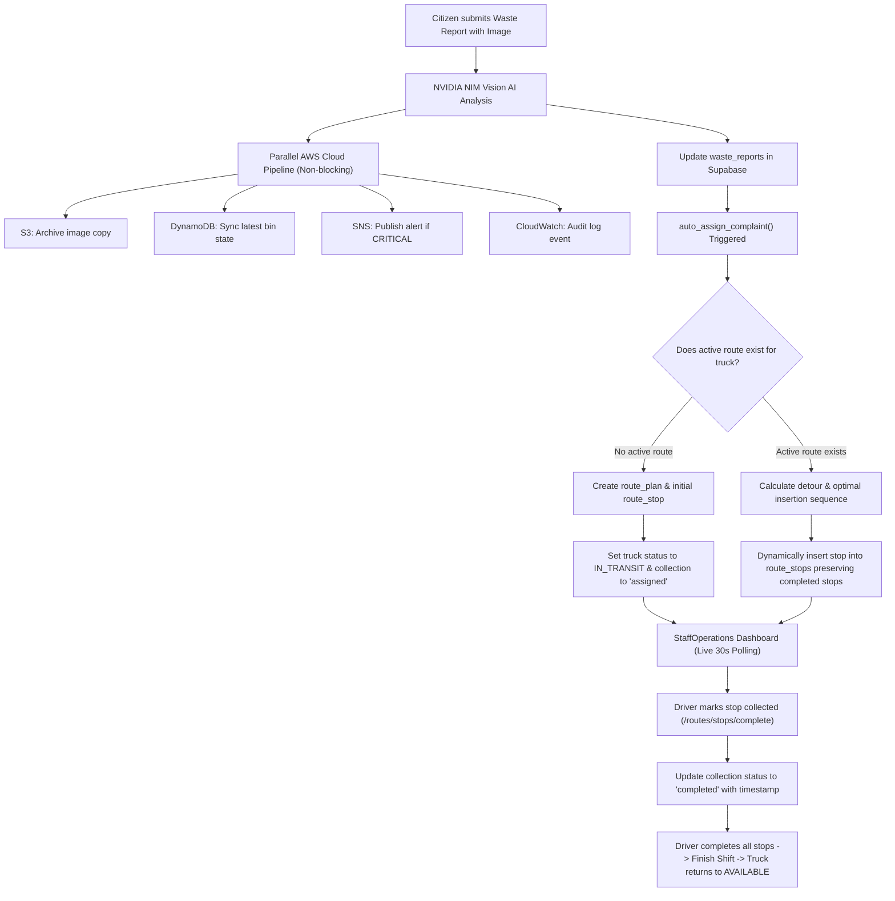

# Merge Completion Report: Automatic Truck Assignment & Dynamic Routing with AWS Cloud Integrations

## Executive Summary
The automatic truck assignment, automatic route generation, dynamic route updating, and staff route management features from the SOURCE project have been merged into the DESTINATION project (`smart-waste-management-dashboard-main`). All existing cloud services—**Supabase PostgreSQL**, **Supabase Authentication**, **Supabase Storage**, and the **4 AWS Services** (Amazon S3, Amazon DynamoDB, Amazon SNS, and Amazon CloudWatch)—remain fully intact, functional, and verified.

---

## 1. Merged Components & File Summary

| File Path | Role / Changes Applied | Status |
| :--- | :--- | :--- |
| `backend/app/services/auto_assign.py` | Core auto-assignment service. Evaluates truck availability, calculates optimal insertion positions via Haversine detour formulas, respects vehicle capacity, and maintains completed stop integrity. | **Merged** |
| `backend/app/routers/reports.py` | Linked complaint creation & AI analysis to `auto_assign_complaint()`. Enriched report responses with collection status & completed timestamps. Preserved AWS S3 archiving and DynamoDB/SNS/CloudWatch post-processing. | **Merged & Cloud-Preserved** |
| `backend/app/routers/routes.py` | Integrated endpoints for `/routes/active`, `/routes/stops/complete`, `/routes/shift/finish`, `/routes/update-active`, `/routes/pending-unassigned`, and `/routes/{id}/cancel`. | **Merged** |
| `backend/app/routers/collections.py` | Added driver validation (`_validate_truck_has_staff_driver`), truck metadata enrichment, and staff assignment checks. | **Merged** |
| `backend/app/services/collection_logic.py` | Configured idempotent status transitions, enabling direct transitions from `assigned` to `completed`. | **Merged** |
| `backend/app/services/ai_service.py` | Added resilient JSON/markdown regex extraction fallback for NVIDIA NIM vision responses. | **Merged** |
| `backend/app/schemas/report.py` | Added `collection_status`, `completed_at`, and `location_name` response fields. | **Merged** |
| `backend/app/schemas/collection.py` | Added `truck_number`, `assigned_staff_id`, `assigned_staff_email`, and `image_url` fields. | **Merged** |
| `frontend/src/components/StaffOperations.jsx` | Implemented active route loading on mount, 30-second live polling loop, dynamic route addition alert banner, interactive map itinerary, and persistent stop completion. | **Merged** |
| `frontend/src/components/DispatchBoard.jsx` | Supports both automatic dispatch status monitoring and manual driver/collection dispatch. | **Merged** |
| `frontend/src/components/ReportWaste.jsx` | Enhanced citizen reporting with interactive location picker, address search, and instant priority assessment. | **Merged** |
| `frontend/src/components/CommandCenter.jsx` | Updated command metrics and fleet monitoring views. | **Merged** |
| `frontend/src/index.css` | Added styling for tactile badges, route progression steps, and live alert banners. | **Merged** |

---

## 2. Core Workflow Architecture

---

## 3. Verification & Test Results

### A. AWS Service Unit Test Suite (`tests/test_aws_services.py`)
- **Status**: **12 / 12 PASSED (100%)**
  - S3 image archiving & private ACL verification: **PASS**
  - DynamoDB partition-key bin sync & fault tolerance: **PASS**
  - SNS critical alert publishing & deduplication: **PASS**
  - CloudWatch audit logging & sanitization: **PASS**
  - Feature-flag non-blocking execution: **PASS**

### B. Shift Lifecycle End-to-End Suite (`tests/test_shift_lifecycle.py`)
- **Status**: **All Scenarios 1–13 PASSED (100%)**
  - Scenario 1: Initial portal mount without active route: **PASS**
  - Scenario 2: Initial route generation & status transition to `IN_TRANSIT`: **PASS**
  - Scenario 3 & 4: Stop completion & persistence across page refresh: **PASS**
  - Scenario 5 & 6: Completion of all stops & truck reset to `AVAILABLE`: **PASS**
  - Scenario 7 & 8: Driver Finish Shift & return to clean start screen: **PASS**
  - Scenario 9: Refresh browser without reopening completed routes: **PASS**
  - Scenario 10: Exclusion of completed complaints from new routes: **PASS**
  - Scenario 11: Dynamic assignment of fresh complaints: **PASS**
  - Scenario 12: Admin dashboard synchronization: **PASS**
  - Scenario 13: Protection against premature shift completion: **PASS**

### C. Automatic Assignment & Dynamic Routing Suite (`tests/test_auto_assign_dynamic_route.py`)
- **Status**: **All 9 Steps PASSED (100%)**
  - Step 1: All 5 fleet trucks validated: **PASS**
  - Step 2: Auto-assignment of Complaint #1 and initial route plan creation: **PASS**
  - Step 3: Route plan & stops persisted with truck `IN_TRANSIT`: **PASS**
  - Step 4: Complaint #2 dynamically inserted into active route (total stops = 2): **PASS**
  - Step 5: Stop 1 marked completed and persisted in database: **PASS**
  - Step 6: Complaint #3 inserted dynamically; completed Stop 1 strictly preserved: **PASS**
  - Step 7: Staff active route API returns live itinerary with accurate completion states: **PASS**
  - Step 8: AWS services (CloudWatch, DynamoDB, SNS) executed successfully: **PASS**
  - Step 9: Shift finished and truck released back to `AVAILABLE`: **PASS**

### D. Frontend Compilation (`npm run build`)
- **Status**: **Built successfully in 660ms with zero errors.**

